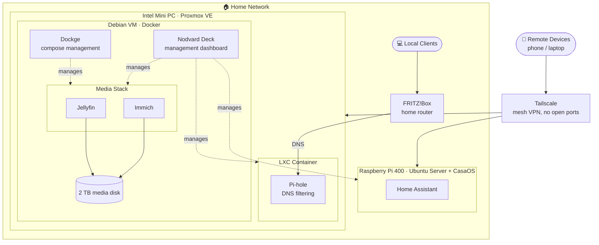
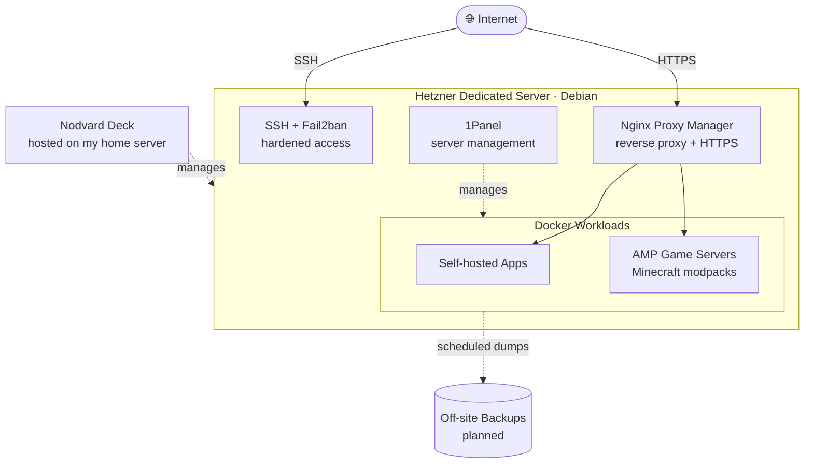

# Hey there, welcome to my profile! 👋

### Future sysadmin · Self-hosting nerd · Homelab tinkerer

---

## 👋 About Me

I love building stuff myself and seeing how it all fits together. My homelab is my playground for Linux, networking, containers and automation, and honestly it's where I've learned most of my practical IT skills.

> [!NOTE]
> **All of this is just for fun.** I'm a vibe coder: I build things together with AI and I don't have deep code knowledge. Where I actually shine is infrastructure (Linux, Docker, networking), and that's the career I'm training for.

| | |
|---|---|
| 🎓 **Training** | IT Specialist for System Integration (FISI) |
| 🔎 **Looking for** | An 8.5-month IT internship |
| 🏠 **Homelab** | Proxmox VE, Docker, Pi-hole, Tailscale |
| ☁️ **Also running** | A rented Hetzner dedicated server |
| 🎮 **Why** | Because it's fun |

---

## 🎯 What I'm Up To Right Now

- 🎓 **Retraining as an IT Specialist for System Integration (FISI):** networking, servers, security and IT projects
- 🔎 **Hunting for an 8.5-month internship in IT** (system integration, sysadmin, infrastructure or support). If you've got an opening or know someone who does, hit me up!
- 🏠 **Building out my homelab:** Proxmox VE on a refurbished Intel mini PC, with a Debian VM for Docker, an LXC container for Pi-hole, a media stack and remote access via Tailscale
- 📦 **Moving house (for my servers):** migrating services from my rented Hetzner server to my own hardware at home
- 📚 **Learning:** more automation, cybersecurity basics, and keeping my setups clean and reproducible

---

## 🛠️ Tech Stack

| Area | Tools |
|---|---|
| **Virtualization & OS** |      |
| **Containers & Management** |    |
| **Self-Hosted Apps** |     |
| **Networking & Security** |     |
| **Dev Tools** *(vibe coded with AI)* |     |

> I've also worked with **WireGuard** before and know my way around it a bit, but these days Tailscale handles my remote access.

---

## 🏠 My Homelab

My homelab runs on a **refurbished Intel mini PC** with **Proxmox VE** as the hypervisor, plus a **Raspberry Pi 400** for smart home stuff.

- 🐳 **Debian VM:** runs Docker with Jellyfin, Immich, Dockge and [Nodvard Deck](https://github.com/nodvard/deck)
- 📦 **LXC container:** runs Pi-hole for DNS filtering
- 🎛️ **Nodvard Deck:** my self-hosted dashboard, managing the home server, the Raspberry Pi and the Hetzner server from one place
- 🔐 **No open ports:** my home router doesn't allow port forwarding, so all remote access goes through Tailscale

---

## ☁️ Bonus: My Rented Server (Hetzner)

Separate from the homelab, I also run an unmanaged **dedicated server at Hetzner** (Debian + Docker). It's home to the stuff that needs a public face, and I'm slowly moving its workloads over to my own hardware.

- 🌐 **Nginx Proxy Manager:** reverse proxy with HTTPS for public services
- 🎮 **AMP:** heavily modded Minecraft game servers
- 🛡️ **SSH + Fail2ban:** hardened remote access
- 🧰 **1Panel:** server management
- 💾 **Off-site backups:** planned

---

## 🖥️ Hardware

| Machine | Role | Specs |
|---|---|---|
| 🏠 **Home server** | Proxmox VE host (Debian Docker VM + Pi-hole LXC) | Refurbished Acer Veriton N4660G · Intel Core i5-9500T · 16 GB RAM · 512 GB SSD · 1 TB Netac NVMe · 2 TB media disk |
| 🍓 **Raspberry Pi 400** | Smart home | Ubuntu Server + CasaOS · Home Assistant |
| ☁️ **Hetzner server** | Public services and game servers | Intel Core i7-6700 (4C/8T) · Intel HD 530 iGPU · ~62 GiB RAM · ~3.5 TB storage |
| 🎮 **Gaming PC** | Gaming and daily driver | AMD Ryzen 7 5700X · MSI MPG B550 Gaming Plus · AMD Radeon RX 9060 XT 16 GB · 32 GB RAM |

---

## 🚀 What I Build & Run

| Project | What it is | Tech |
|---|---|---|
| 🎬 **Home media & photos** | My own media server and photo library | Jellyfin, Immich, Docker |
| 🎮 **Game server hosting** | Heavily modded Minecraft servers, tuned with profiling | AMP, Docker, Java |
| 🧩 **Client-side mods** | Hobby mods and addons for games, built with AI help | Java |
| 🌐 **Network services** | DNS-level ad/tracker blocking, mesh VPN, reverse proxy with TLS | Pi-hole, Tailscale, Nginx Proxy Manager |
| 💡 **Smart home** | Home automation running on a Raspberry Pi | Home Assistant, Docker, Raspberry Pi |

**The fun bits**

- 🧱 **Virtualized base:** Proxmox VE underneath, a Debian VM with Docker and a Pi-hole LXC on top
- 🎮 **Squeezing performance:** profiling and tuning hungry Minecraft modpack servers
- 🔁 **Migration mode:** planning and moving services, data and media between hosts step by step

---

## 🧰 How I Roll

| | |
|---|---|
| 🎉 **Fun first** | This is my hobby. I build things because it's enjoyable, not because I have to |
| 🔧 **Hands-on** | I learn fastest by building, breaking and fixing real systems |
| 🤖 **Vibe coding, honestly** | I use AI assistants to write code, and I'm upfront that I don't have deep programming knowledge. Code is a tool for me; my focus is getting systems running and understanding the infrastructure around them |
| 🛠️ **Tooling** | VS Code, Git and AI assistance |
| 🧠 **Mindset** | Troubleshoot step by step, automate the boring stuff, keep things simple |

---

## 📫 Let's Connect

I'm actively looking for an **IT internship (8.5 months)** in system integration or administration. 
Feel free to reach out via GitHub, or open an issue or discussion on one of my repos.

Built with Markdown, Mermaid and way too much curiosity. 🛠️

