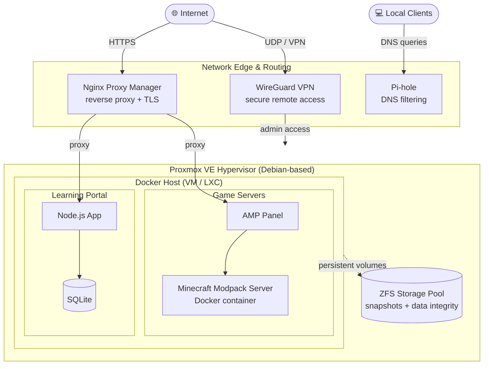

# Hi, welcome to my profile! 👋

**Aspiring Systems Integrator | Self-Hosting Enthusiast | Homelab Builder**

I like to understand how things work by building them myself. My homelab is my playground for infrastructure, networking, containers and automation, and it's where most of my practical IT skills come from.

---

## 🎯 Current Focus

- 🎓 **Finishing my retraining as an IT Specialist for System Integration (FISI)**, covering networking, server administration, security and IT project work
- 🔎 **Looking for an 8.5-month internship in IT** (system integration, system administration, infrastructure or support). If you have an opening or know someone who does, I'd love to connect!
- 🧪 **Homelab projects:** hardening and documenting my setup, improving backup and monitoring, and migrating workloads to my own hardware
- 📚 **Learning:** more automation, cybersecurity fundamentals, and clean, reproducible infrastructure

---

## 🛠️ Skills & Tech Stack

### Virtualization & Operating Systems

### Networking & Security

### Containers & Self-Hosting

### Development

### AI-Assisted Workflows

---

## 🏗️ Homelab Architecture

Everything runs on a single Proxmox VE hypervisor with ZFS-backed storage. External access goes through a reverse proxy and a WireGuard VPN, while Pi-hole handles DNS filtering for the local network. Workloads are containerized with Docker.

**Highlights**

- 🔐 **Secure by default:** services are published through a reverse proxy, and administration is done over VPN
- 💾 **Data integrity first:** ZFS provides snapshots and checksummed storage for persistent data
- 🐳 **Reproducible workloads:** services run in Docker containers with persistent volumes
- 🎮 **Performance tuning:** resource-hungry Minecraft modpack servers (profiling, JVM and mod optimization) run in containers managed via AMP

---

## 🚀 What I Build & Run

| Project | What it is | Tech |
|---|---|---|
| **Self-hosted learning portal** | A web app with exercises and user accounts for fellow learners | Node.js, SQLite, Docker |
| **Game server hosting** | Dedicated, heavily modded Minecraft servers with performance profiling | AMP, Docker, Java |
| **Client-side mods** | Custom client-side mods and addons | Java |
| **Network services** | Ad/tracker blocking, VPN access, reverse proxy with TLS | Pi-hole, WireGuard, Nginx Proxy Manager |
| **Storage management** | Pool design, snapshots and data integrity | ZFS |

---

## 🧰 How I Work

- **Hands-on first:** I learn fastest by building, breaking and fixing real systems
- **Documentation matters:** if I can't explain a setup, I don't consider it finished
- **Tooling:** VS Code, Git, and local LLMs as a coding companion (I review and understand what I ship)
- **Mindset:** troubleshoot systematically, automate repetitive work, and keep things simple and maintainable

---

## 📫 Let's Connect

I'm actively looking for an **IT internship (8.5 months)** in system integration or administration. Feel free to reach out via GitHub, or open an issue or discussion on one of my repositories.

---

Built with Markdown, Mermaid and a lot of curiosity. 🛠️
